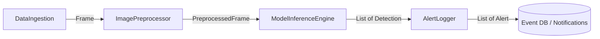

# Modular Software Design - Computer Vision Pipeline (Lab 02, Task 4)

**Course:** AI Project Design and Development (AI-316)

## 1. Overview

The end-to-end application is split into four independent modules with a single shared data contract (`src/data_types.py`) and a thin orchestrator (`src/pipeline.py`). Modules never import each other; they exchange only the dataclasses below, so any module can be swapped (for example an ONNX engine instead of Ultralytics) without changing the rest.



## 2. Module Responsibilities

| Module | File | Responsibility | Main input | Main return type |
|--------|------|----------------|------------|------------------|
| `DataIngestion` | `src/data_ingestion.py` | Acquires timestamped frames from a webcam, video file or RTSP stream; reconnects on failure; releases the source. | `source: int | str` | `Optional[Frame]` |
| `ImagePreprocessor` | `src/image_preprocessor.py` | Letterbox-resizes to the model input size, converts BGR to RGB, scales to [0, 1], reorders to NCHW and records scale/padding. | `Frame` | `PreprocessedFrame` |
| `ModelInferenceEngine` | `src/model_inference_engine.py` | Loads weights, warms up, runs detection with confidence/NMS thresholds and maps boxes back to original-frame pixels. | `PreprocessedFrame` | `List[Detection]` |
| `AlertLogger` | `src/alert_logger.py` | Evaluates alert rules on detections, stores events in SQLite and a log file, and calls a notifier. | `Frame`, `List[Detection]` | `List[Alert]` |

## 3. Shared Data Contract

```python
"""Shared data containers passed between pipeline modules."""
from __future__ import annotations

from dataclasses import dataclass, field
from datetime import datetime
from typing import Dict, List, Tuple

import numpy as np


@dataclass(frozen=True)
class Frame:
    """A single decoded video frame."""
    image: np.ndarray          # H x W x 3, uint8, BGR
    frame_id: int
    timestamp: datetime
    source_id: str = "cam0"


@dataclass(frozen=True)
class PreprocessedFrame:
    """Frame converted to model input format plus the info needed to undo it."""
    tensor: np.ndarray                 # 1 x 3 x H x W, float32, range [0, 1]
    original_shape: Tuple[int, int]    # (height, width) of the source frame
    scale: float                       # resize ratio used
    pad: Tuple[int, int]               # (pad_x, pad_y) added by letterboxing
    frame: Frame


@dataclass(frozen=True)
class Detection:
    """One detected object, in original-frame pixel coordinates."""
    class_id: int
    label: str
    confidence: float
    bbox: Tuple[int, int, int, int]    # (x1, y1, x2, y2)


@dataclass(frozen=True)
class Alert:
    """An alert raised by a rule."""
    rule_name: str
    severity: str                      # "info" | "warning" | "critical"
    message: str
    frame_id: int
    timestamp: datetime
    detections: List[Detection] = field(default_factory=list)


Config = Dict[str, object]
```

## 4. Module Interfaces and Skeleton Code

Method signatures, inputs and return types are given in the type hints and docstrings of each class.

### 4.1 DataIngestion (`src/data_ingestion.py`)

**Responsibility:** Acquires timestamped frames from a webcam, video file or RTSP stream; reconnects on failure; releases the source.

```python
"""Module 1 - DataIngestion: acquires frames from a camera, RTSP stream or file."""
from __future__ import annotations

from abc import ABC, abstractmethod
from datetime import datetime
from typing import Iterator, Optional, Union

from .data_types import Frame


class BaseDataIngestion(ABC):
    """Interface every frame source must implement."""

    @abstractmethod
    def open(self) -> bool:
        """Connect to the source. Returns True on success."""

    @abstractmethod
    def read_frame(self) -> Optional[Frame]:
        """Return the next Frame, or None if the stream ended or failed."""

    @abstractmethod
    def close(self) -> None:
        """Release the source and any resources."""

    @abstractmethod
    def is_opened(self) -> bool:
        """True while the source is connected."""

    def frames(self) -> Iterator[Frame]:
        """Iterate over frames until the source ends."""
        while True:
            frame = self.read_frame()
            if frame is None:
                break
            yield frame


class DataIngestion(BaseDataIngestion):
    """OpenCV-backed ingestion for webcams (int), video files and RTSP URLs (str)."""

    def __init__(self, source: Union[int, str], source_id: str = "cam0",
                 reconnect_attempts: int = 3) -> None:
        self.source = source
        self.source_id = source_id
        self.reconnect_attempts = reconnect_attempts
        self._cap = None
        self._frame_id = 0

    def open(self) -> bool:
        import cv2  # imported lazily so the module can be imported without OpenCV
        self._cap = cv2.VideoCapture(self.source)
        return self._cap.isOpened()

    def read_frame(self) -> Optional[Frame]:
        if self._cap is None:
            raise RuntimeError("Call open() before read_frame().")
        for _ in range(self.reconnect_attempts + 1):
            ok, image = self._cap.read()
            if ok:
                self._frame_id += 1
                return Frame(image, self._frame_id, datetime.now(), self.source_id)
            self.close()
            if not self.open():
                continue
        return None

    def close(self) -> None:
        if self._cap is not None:
            self._cap.release()
            self._cap = None

    def is_opened(self) -> bool:
        return self._cap is not None and self._cap.isOpened()
```

### 4.2 ImagePreprocessor (`src/image_preprocessor.py`)

**Responsibility:** Letterbox-resizes to the model input size, converts BGR to RGB, scales to [0, 1], reorders to NCHW and records scale/padding.

```python
"""Module 2 - ImagePreprocessor: converts raw frames to model-ready tensors."""
from __future__ import annotations

from typing import Tuple

import numpy as np

from .data_types import Frame, PreprocessedFrame


class ImagePreprocessor:
    """Letterbox resize, BGR->RGB, scale to [0, 1], HWC->NCHW."""

    def __init__(self, target_size: Tuple[int, int] = (640, 640),
                 pad_value: int = 114) -> None:
        self.target_size = target_size      # (height, width)
        self.pad_value = pad_value

    def process(self, frame: Frame) -> PreprocessedFrame:
        """Prepare one frame for inference."""
        import cv2
        h, w = frame.image.shape[:2]
        th, tw = self.target_size
        scale = min(th / h, tw / w)
        new_w, new_h = int(round(w * scale)), int(round(h * scale))
        resized = cv2.resize(frame.image, (new_w, new_h), interpolation=cv2.INTER_LINEAR)

        pad_x, pad_y = (tw - new_w) // 2, (th - new_h) // 2
        canvas = np.full((th, tw, 3), self.pad_value, dtype=np.uint8)
        canvas[pad_y:pad_y + new_h, pad_x:pad_x + new_w] = resized

        rgb = canvas[:, :, ::-1]
        tensor = np.ascontiguousarray(rgb.transpose(2, 0, 1), dtype=np.float32) / 255.0
        return PreprocessedFrame(tensor[None], (h, w), scale, (pad_x, pad_y), frame)

    def process_batch(self, frames: list) -> list:
        """Preprocess a list of frames."""
        return [self.process(f) for f in frames]
```

### 4.3 ModelInferenceEngine (`src/model_inference_engine.py`)

**Responsibility:** Loads weights, warms up, runs detection with confidence/NMS thresholds and maps boxes back to original-frame pixels.

```python
"""Module 3 - ModelInferenceEngine: loads a detector and returns detections."""
from __future__ import annotations

from abc import ABC, abstractmethod
from typing import List

from .data_types import Detection, PreprocessedFrame


class BaseInferenceEngine(ABC):
    @abstractmethod
    def load_model(self) -> None:
        """Load weights into memory (and onto the device)."""

    @abstractmethod
    def predict(self, item: PreprocessedFrame) -> List[Detection]:
        """Run detection on one preprocessed frame."""

    @abstractmethod
    def warmup(self, runs: int = 3) -> None:
        """Run dummy inferences so the first real frame is not slow."""


class ModelInferenceEngine(BaseInferenceEngine):
    """Ultralytics YOLO wrapper. Returns boxes mapped back to original frame pixels."""

    def __init__(self, weights_path: str = "models/yolov8n.pt",
                 conf_threshold: float = 0.25, iou_threshold: float = 0.45,
                 device: str = "cpu") -> None:
        self.weights_path = weights_path
        self.conf_threshold = conf_threshold
        self.iou_threshold = iou_threshold
        self.device = device
        self._model = None

    def load_model(self) -> None:
        from ultralytics import YOLO
        self._model = YOLO(self.weights_path)

    def warmup(self, runs: int = 3) -> None:
        import numpy as np
        if self._model is None:
            self.load_model()
        dummy = np.zeros((640, 640, 3), dtype=np.uint8)
        for _ in range(runs):
            self._model.predict(dummy, verbose=False, device=self.device)

    def predict(self, item: PreprocessedFrame) -> List[Detection]:
        if self._model is None:
            raise RuntimeError("Call load_model() before predict().")
        # Ultralytics does its own letterbox, so the original BGR frame is passed.
        result = self._model.predict(
            item.frame.image, conf=self.conf_threshold, iou=self.iou_threshold,
            device=self.device, verbose=False)[0]
        names = result.names
        detections: List[Detection] = []
        for box in result.boxes:
            x1, y1, x2, y2 = (int(v) for v in box.xyxy[0].tolist())
            cls = int(box.cls[0])
            detections.append(Detection(cls, names[cls], float(box.conf[0]), (x1, y1, x2, y2)))
        return detections
```

### 4.4 AlertLogger (`src/alert_logger.py`)

**Responsibility:** Evaluates alert rules on detections, stores events in SQLite and a log file, and calls a notifier.

```python
"""Module 4 - AlertLogger: evaluates alert rules, stores events, sends notifications."""
from __future__ import annotations

import json
import logging
import sqlite3
from datetime import datetime
from typing import Callable, List, Optional

from .data_types import Alert, Detection, Frame

NotifyFn = Callable[[Alert], None]


class AlertLogger:
    """Applies simple label/confidence rules, logs events to SQLite and a log file."""

    def __init__(self, db_path: str = "logs/events.db", log_file: str = "logs/app.log",
                 watch_labels: Optional[List[str]] = None, min_confidence: float = 0.5,
                 notifier: Optional[NotifyFn] = None) -> None:
        self.watch_labels = set(watch_labels or ["person"])
        self.min_confidence = min_confidence
        self.notifier = notifier
        self._logger = logging.getLogger("alert_logger")
        if not self._logger.handlers:
            self._logger.addHandler(logging.FileHandler(log_file))
            self._logger.setLevel(logging.INFO)
        self._db = sqlite3.connect(db_path)
        self._db.execute(
            "CREATE TABLE IF NOT EXISTS events ("
            "id INTEGER PRIMARY KEY AUTOINCREMENT, ts TEXT, frame_id INTEGER, "
            "rule TEXT, severity TEXT, message TEXT, detections TEXT)")
        self._db.commit()

    def evaluate(self, frame: Frame, detections: List[Detection]) -> List[Alert]:
        """Return the alerts triggered by this frame's detections."""
        hits = [d for d in detections
                if d.label in self.watch_labels and d.confidence >= self.min_confidence]
        if not hits:
            return []
        labels = ", ".join(sorted({d.label for d in hits}))
        return [Alert("watchlist_object", "warning",
                      f"{len(hits)} object(s) detected: {labels}",
                      frame.frame_id, datetime.now(), hits)]

    def log_event(self, alert: Alert) -> int:
        """Persist an alert; returns the new row id."""
        payload = json.dumps([d.__dict__ for d in alert.detections])
        cur = self._db.execute(
            "INSERT INTO events (ts, frame_id, rule, severity, message, detections) "
            "VALUES (?, ?, ?, ?, ?, ?)",
            (alert.timestamp.isoformat(), alert.frame_id, alert.rule_name,
             alert.severity, alert.message, payload))
        self._db.commit()
        self._logger.info("%s | %s | %s", alert.severity, alert.rule_name, alert.message)
        return int(cur.lastrowid)

    def send_notification(self, alert: Alert) -> bool:
        """Call the configured notifier. Returns True if one was called."""
        if self.notifier is None:
            return False
        self.notifier(alert)
        return True

    def handle(self, frame: Frame, detections: List[Detection]) -> List[Alert]:
        """Evaluate rules, log and notify. Convenience entry point for the pipeline."""
        alerts = self.evaluate(frame, detections)
        for a in alerts:
            self.log_event(a)
            self.send_notification(a)
        return alerts

    def close(self) -> None:
        self._db.close()
```

### 4.5 DetectionPipeline (`src/pipeline.py`)

**Responsibility:** connects the four modules, runs the frame loop and guarantees resource cleanup.

```python
"""Wires the four modules together: ingest -> preprocess -> infer -> alert/log."""
from __future__ import annotations

from typing import Optional

from .alert_logger import AlertLogger
from .data_ingestion import BaseDataIngestion
from .image_preprocessor import ImagePreprocessor
from .model_inference_engine import BaseInferenceEngine


class DetectionPipeline:
    def __init__(self, ingestion: BaseDataIngestion, preprocessor: ImagePreprocessor,
                 engine: BaseInferenceEngine, alert_logger: AlertLogger) -> None:
        self.ingestion = ingestion
        self.preprocessor = preprocessor
        self.engine = engine
        self.alert_logger = alert_logger

    def run(self, max_frames: Optional[int] = None) -> int:
        """Process frames until the source ends or max_frames is reached.
        Returns the number of frames processed."""
        if not self.ingestion.open():
            raise RuntimeError("Could not open video source.")
        self.engine.load_model()
        self.engine.warmup()
        count = 0
        try:
            for frame in self.ingestion.frames():
                item = self.preprocessor.process(frame)
                detections = self.engine.predict(item)
                self.alert_logger.handle(frame, detections)
                count += 1
                if max_frames is not None and count >= max_frames:
                    break
        finally:
            self.ingestion.close()
            self.alert_logger.close()
        return count
```

## 5. Design Principles

| Principle | How it is applied |
|-----------|-------------------|
| Single responsibility | One job per module (acquire, prepare, infer, alert/log). |
| Dependency inversion | `BaseDataIngestion` and `BaseInferenceEngine` are abstract interfaces; the pipeline depends on them, not on concrete classes. |
| Loose coupling | Modules exchange immutable dataclasses (`Frame`, `PreprocessedFrame`, `Detection`, `Alert`). |
| Testability | Each module can be tested alone with synthetic frames; heavy imports (`cv2`, `ultralytics`) are lazy. |
| Configurability | Model path, thresholds, watch-list and storage paths are constructor arguments. |
